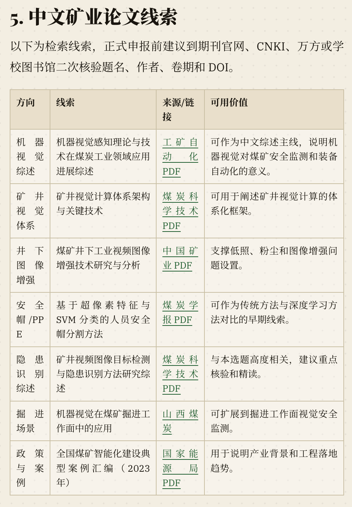
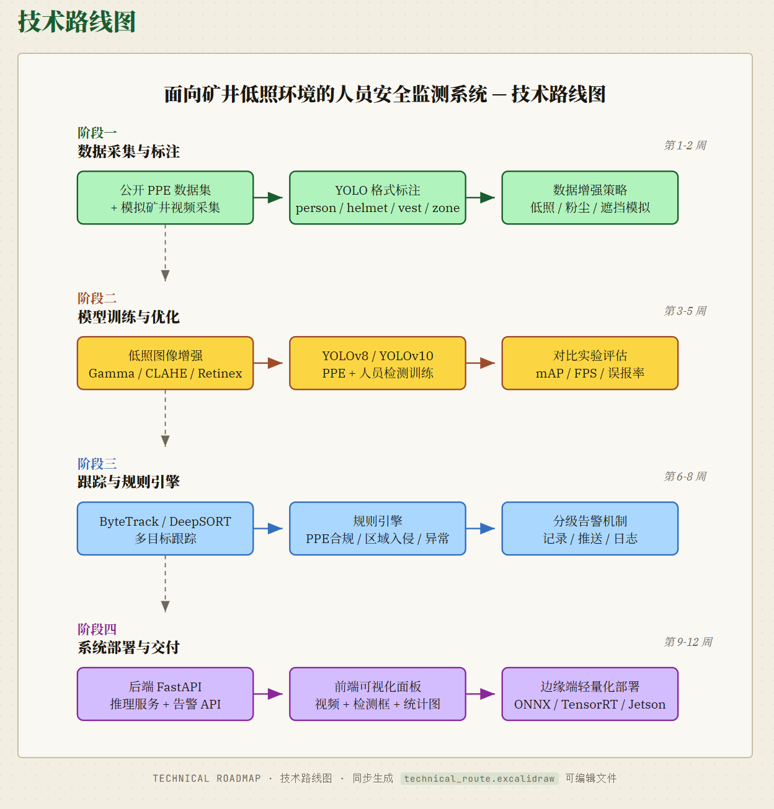
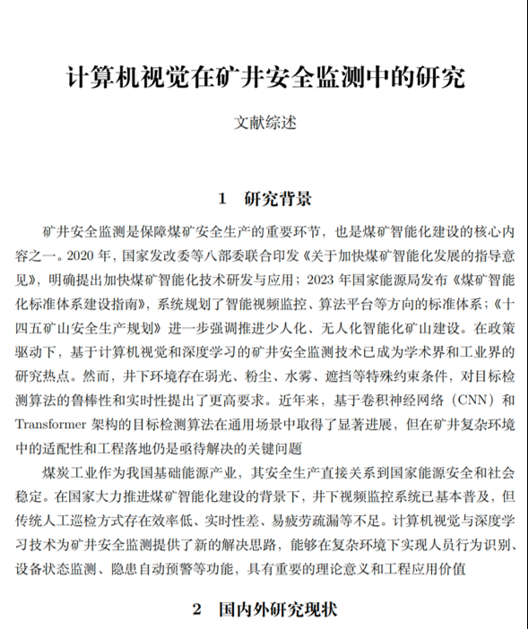
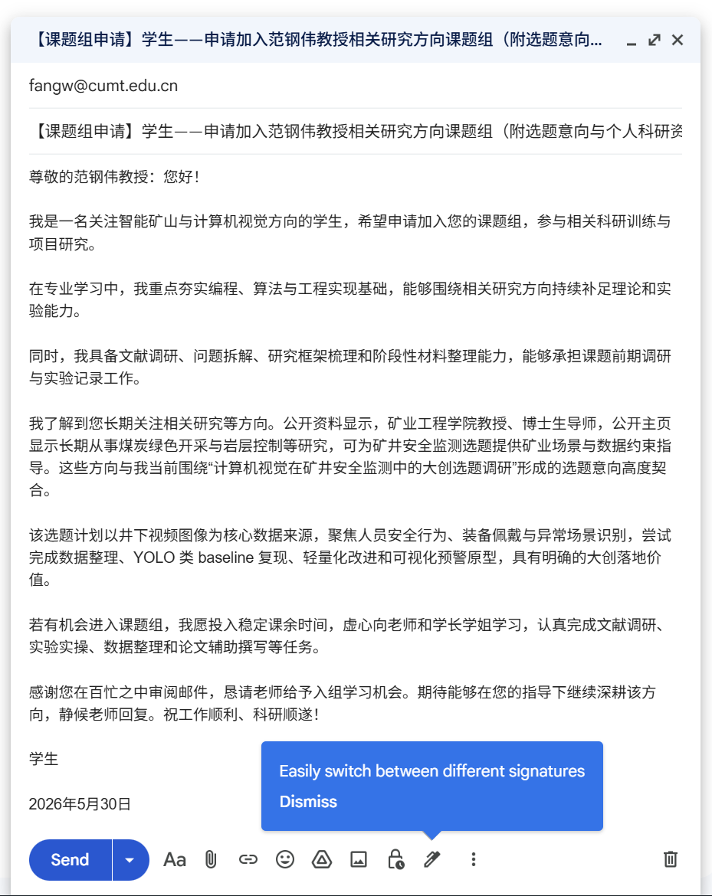
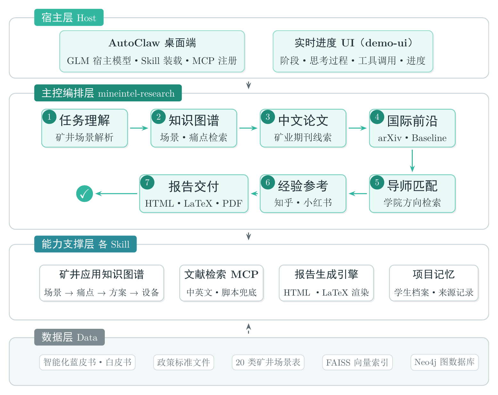

<p align="center">
  
</p>

<h1 align="center">MineIntel-AutoClaw 矿小智</h1>

<h3 align="center">基于多智能体协作的矿业科创调研与孵化助手</h3>

<p align="center">
  <a href="README_EN.md">English</a> · <strong>中文</strong>
</p>

<p align="center">
  <a href="https://github.com/Richard110206/MineIntel-Autoclaw/stargazers">
    
  </a>
  <a href="https://github.com/zhipu-ai/autoclaw">
    
  </a>
  
  
  
  
  
</p>

---

## 成果与荣誉

> 🏆 **2026 年（第 19 届）中国大学生计算机设计大赛**「软件应用与开发」类 **国家一等奖**，并入选特色作品点评 · 济南决赛区（山东青岛） · 中国矿业大学 · [官方获奖公告](https://jsjds.blcu.edu.cn/info/1041/2914.htm)

项目以多智能体协作编排、矿井应用知识图谱和端到端科研调研交付能力为核心，面向矿业科创选题提供从场景分析、文献检索、Baseline 推荐到成果生成的一体化支持。

---

## 核心功能

<table>
<tr>
<td width="50%" align="center">

**科研情报海报**<br>
以海报版式呈现调研的具体内容——研究主题、关键场景、技术路线与结论要点浓缩一页，可读性优先。


</td>
<td width="50%" align="center">

**技术路线图自动生成**<br>
基于调研结论生成 Excalidraw 技术路线图并嵌入报告对应章节。


</td>
</tr>
<tr>
<td width="50%" align="center">

**PDF 文献综述**<br>
结构化文献综述以 LaTeX 编译为 PDF，含规范的章节、引用与参考文献排版。


</td>
<td width="50%" align="center">

**导师邮件草稿**<br>
一键生成可直接发给导师的套磁邮件，浏览器预填 Gmail、本地预览确认，不自动发送。


</td>
</tr>
</table>

---

## 系统架构

<p align="center">
  
</p>

**MineIntel-AutoClaw（矿小智）** 基于 [AutoClaw](https://github.com/zhipu-ai/autoclaw) 原生 Skill 架构构建：宿主层的 GLM 模型按 Skill 定义调度 7 步调研流水线，能力支撑层的各 Skill 提供知识图谱检索、文献 MCP、报告引擎与项目记忆，数据层沉淀白皮书语料、场景表、向量索引与图数据库。

项目定位为**面向中国矿业大学与矿井场景的个性化科创调研助手**：读取学生过往项目与本人贡献，结合兴趣、时间、团队及数据设备约束，调研矿井需求并推荐可完成的选题。每个学生使用独立本地档案（由 `project_memory.py` 管理，支持查看、更新、删除与来源记录，格式见[项目记忆说明](MineIntel-AutoClaw-Skill/mineintel-research/references/project-memory.md)），推荐方案不会自动成为"已掌握能力"，也不自动训练模型或循环执行实验——报告与导出仅使用实际提供的材料。

---

## 技能组结构

| 技能 | 说明 | 核心能力 |
|:-----|:-----|:---------|
| `mineintel-research` | 主控闭环 Skill | 端到端任务编排，7 步流水线调度 |
| `mineintel-application-kg` | 矿井应用知识图谱 | 场景-痛点-解决方案结构化检索 |
| `mineintel-knowledge-rag` | 本地知识库与导师匹配 | RAG 检索 + 官网导师推荐 |
| `mineintel-literature-baseline` | 论文线索与 Baseline | MCP 工具 + 中英文论文检索 |
| `mineintel-experience-insights` | 科研经验参考 | 知乎/小红书经验提炼 |
| `mineintel-report-export` | 报告交付编排 | HTML + LaTeX/PDF 导出 |
| `mineintel-html-poster` | HTML 海报报告 | Magazine-poster 风格渲染 |
| `mineintel-literature-review` | 文献综述生成 | LaTeX 结构化综述 + PDF 编译 |
| `mineintel-email-draft` | 导师邮件草稿 | 浏览器预填 Gmail + 本地预览，不自动发送 |

---

## 快速开始

### 环境要求

- [AutoClaw](https://github.com/zhipu-ai/autoclaw) Desktop App
- Python 3.10+
- [UV](https://docs.astral.sh/uv/)（推荐）或 pip
- （可选）XeLaTeX — 用于 PDF 编译

### 安装

```bash
# 1. 克隆仓库
git clone git@github.com:Richard110206/MineIntel-Autoclaw.git
cd MineIntel-Autoclaw/MineIntel-AutoClaw-Skill

# 2. 安装依赖（推荐 UV：一键创建 .venv 并按 uv.lock 安装）
uv sync
# 没有 uv 时可用：python -m pip install -r requirements-advanced.txt

# 3. 在 AutoClaw 桌面端通过「添加技能」导入整个 MineIntel-AutoClaw-Skill 文件夹
#    文件夹内含顶层 SKILL.md，导入后技能组会被自动识别

# 4. （可选）配置检索服务环境变量（参见 .env.example）：
#    AUTOGLM_APP_ID / AUTOGLM_APP_KEY     AutoGLM 网页搜索
#    MINEINTEL_NEO4J_PASSWORD 等          Neo4j 知识图谱（docker compose -f docker-compose.neo4j.yml up -d）
#    首次使用需构建 FAISS 索引：python mineintel-knowledge-rag/scripts/build_faiss_index.py

# 5. （可选）如果 AutoClaw 支持 MCP 注册，配置文献检索 MCP Server：
#    参见 mineintel-literature-baseline/mcp_servers/mcp_config.json
```

### 使用方法

1. 打开 AutoClaw 桌面端，在技能管理中点击**「添加技能」**，选择整个 `MineIntel-AutoClaw-Skill` 文件夹（含顶层 `SKILL.md`，无需逐个导入子技能）；
2. 在 AutoClaw 对话中发送以下提示词，即可触发完整的科研调研流程：

```
请使用 MineIntel-AutoClaw-Skill（矿小智）技能组，围绕"计算机视觉在矿井安全监测中的大创选题"生成科研调研报告。
我的专业是软件工程。
我想研究的技术领域是计算机视觉。
矿业场景是矿井安全监测。
```

输出将保存到 `output/<时间戳_报告标题>/` 目录：

| 文件 | 说明 |
|:-----|:-----|
| `<标题>_poster.html` | HTML 完整报告（magazine-poster 风格） |
| `<标题>_deck.html` | 逐页展示版 HTML Deck |
| `assets/<标题>_technical_route.excalidraw` | 技术路线图源文件（已嵌入 HTML 报告技术路线章节） |
| `<标题>_literature_review.tex` | 文献综述 LaTeX 源码 |
| `<标题>_literature_review.pdf` | 文献综述 PDF（需 XeLaTeX） |

---

## 数据来源

| 来源 | 类型 | 用途 |
|:-----|:-----|:-----|
| 煤矿智能化蓝皮书（2025） | 白皮书 | 知识图谱构建 |
| 煤矿智能化建设指南（2021） | 政策标准 | 场景依据 |
| 国家矿山安全监察局政策 | 政策文件 | 行业背景 |
| 5G 智慧矿山白皮书 | 行业白皮书 | 技术参考 |
| 华为/中兴/中国电信矿山方案 | 企业方案 | 技术路线 |
| ABB/Siemens/Schneider Mining | 国际方案 | 前沿对比 |
| 矿井场景总览（20 场景） | 人工标注 | 高置信骨架 |

---

## 项目结构

```
MineIntel-AutoClaw-Skill/
├── SKILL.md                          # 总入口 Skill
├── demo_prompts.txt                  # 演示提示词
│
├── mineintel-research/               # 主控闭环 Skill
│   ├── SKILL.md
│   ├── scripts/                      # 主控脚本（进度、导师、论文检索等）
│   └── references/                   # 参考文档
│
├── mineintel-application-kg/         # 知识图谱 Skill
│   └── data/                         # 原始文档、清洗语料、图谱数据
│
├── mineintel-knowledge-rag/          # 知识库 Skill（RAG + 导师匹配）
├── mineintel-literature-baseline/    # 论文检索 Skill（含 MCP Server）
├── mineintel-experience-insights/    # 经验参考 Skill
├── mineintel-report-export/          # 报告导出 Skill
├── mineintel-html-poster/            # HTML 海报 Skill
├── mineintel-literature-review/      # 文献综述 Skill
├── mineintel-email-draft/            # 浏览器 Gmail 邮件草稿 Skill
│
├── demo-ui/                          # 实时进度 UI
├── output/                           # 报告输出目录
└── tools/                            # 辅助工具
```

---

## 团队与许可

<p align="center">
  <a href="https://github.com/Richard110206">
    
  </a>
</p>

本项目基于 [MIT 许可证](LICENSE) 开源，基于 [AutoClaw](https://github.com/zhipu-ai/autoclaw) Skill 架构构建。
