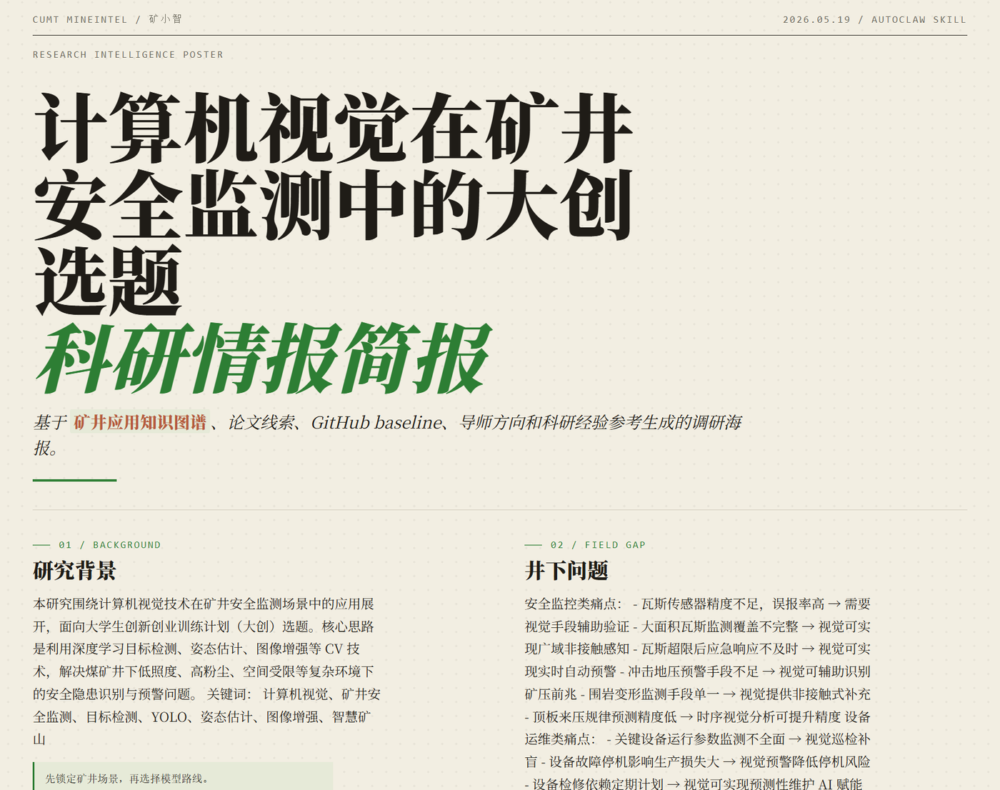
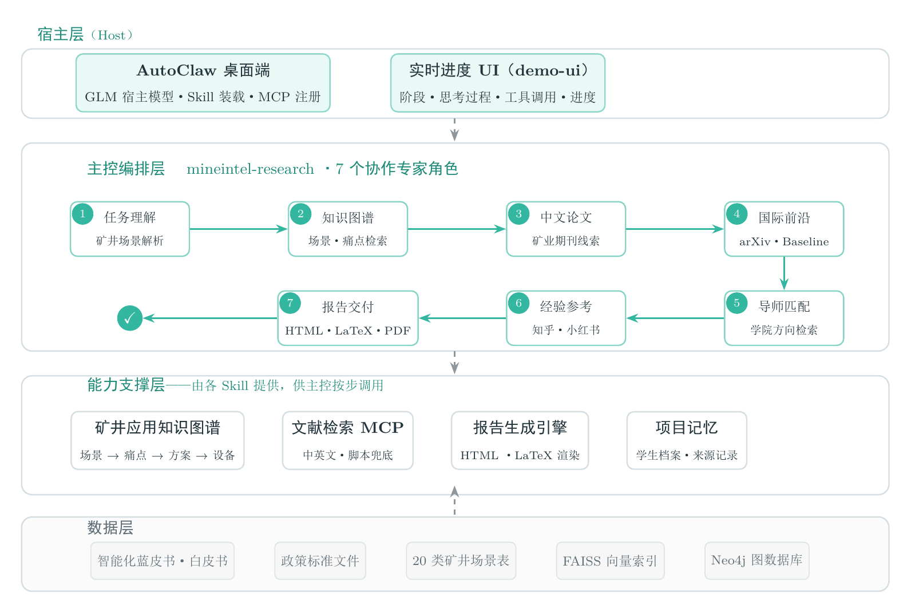

<p align="center">
  
</p>

<h1 align="center">MineIntel-AutoClaw</h1>

<h3 align="center">A multi-agent research & incubation assistant for mining sci-tech innovation</h3>

<p align="center">
  <strong>English</strong> · <a href="README.md">中文</a>
</p>

<p align="center">
  <a href="https://github.com/Richard110206/MineIntel-Autoclaw/stargazers">
    
  </a>
  <a href="https://github.com/zhipu-ai/autoclaw">
    
  </a>
  
  
  
  
  
</p>

---

## Awards

> 🏆 **First Prize (National Level)**, Software Application & Development track, 2026 China Collegiate Computing Contest (19th edition), selected for the featured-works commentary · Jinan finals (Qingdao, Shandong) · China University of Mining and Technology · [Official announcement](https://jsjds.blcu.edu.cn/info/1041/2914.htm) (in Chinese)

The project centers on multi-agent orchestration, a mining-application knowledge graph, and end-to-end research delivery — supporting the full pipeline from scenario analysis, literature search, and baseline recommendation to deliverable generation for mining-focused innovation topics.

---

## Key Features

<table>
<tr>
<td width="50%" align="center">

**Full HTML Report**<br>
Auto-generates a magazine-poster style HTML research report covering topic, scenario analysis, paper leads, and technical route.


</td>
<td width="50%" align="center">

**LaTeX/PDF Poster Report**<br>
A LaTeX-typeset poster-style report compiled to PDF (screenshot of an actual compiled output).


</td>
</tr>
<tr>
<td width="50%" align="center">

**Automatic Technical-Route Diagrams**<br>
Excalidraw technical route diagrams generated from research conclusions and embedded into the report.


</td>
<td width="50%" align="center">

**PDF Literature Review**<br>
A structured literature review compiled to PDF with proper sections, citations, and bibliography.


</td>
</tr>
</table>

---

## Architecture

<p align="center">
  
</p>

**MineIntel-AutoClaw** is built on the native Skill architecture of [AutoClaw](https://github.com/zhipu-ai/autoclaw): the host-layer GLM model drives a 7-step research pipeline defined by Skills; the support layer provides knowledge-graph retrieval, a literature MCP, the report engine, and project memory; the data layer holds white-book corpora, scenario tables, vector indexes, and a graph database.

The assistant is positioned as a **personalized research scout for China University of Mining and Technology and mine-site scenarios**: it reads a student's past projects and contributions, weighs interests, time, team, and equipment constraints, then surveys mining needs and recommends feasible topics. Each student gets an isolated local profile (managed by `project_memory.py` with view/update/delete and source tracking; see the [project memory reference](MineIntel-AutoClaw-Skill/mineintel-research/references/project-memory.md)). Recommended topics never become "mastered skills" automatically; no model training or experiment loops are performed — reports and exports use only the materials actually provided.

---

## Skill Set

| Skill | Description | Capability |
|:------|:------------|:-----------|
| `mineintel-research` | Master orchestration Skill | End-to-end task orchestration, 7-step pipeline |
| `mineintel-application-kg` | Mining application KG | Scenario-pain point-solution structured retrieval |
| `mineintel-knowledge-rag` | Local knowledge base & advisors | RAG retrieval + faculty recommendation |
| `mineintel-literature-baseline` | Paper leads & baselines | MCP tools + CN/EN literature search |
| `mineintel-experience-insights` | Research experience reference | Zhihu/Xiaohongshu insight distillation |
| `mineintel-report-export` | Report delivery orchestration | HTML + LaTeX/PDF export |
| `mineintel-html-poster` | HTML poster report | Magazine-poster style rendering |
| `mineintel-literature-review` | Literature review generation | Structured LaTeX review + PDF |
| `mineintel-email-draft` | Advisor email draft | Browser Gmail pre-fill + local preview, no auto-send |

---

## Getting Started

### Prerequisites

- [AutoClaw](https://github.com/zhipu-ai/autoclaw) Desktop App
- Python 3.10+
- [UV](https://docs.astral.sh/uv/) (recommended) or pip
- (Optional) XeLaTeX — for PDF compilation

### Installation

```bash
# 1. Clone the repository
git clone git@github.com:Richard110206/MineIntel-Autoclaw.git
cd MineIntel-Autoclaw/MineIntel-AutoClaw-Skill

# 2. Install dependencies (UV recommended: creates .venv from uv.lock in one step)
uv sync
# Or without uv: python -m pip install -r requirements-advanced.txt

# 3. In the AutoClaw desktop app, use "Add Skill" to import the whole MineIntel-AutoClaw-Skill folder
#    (it contains the top-level SKILL.md; the skill group is auto-detected)

# 4. (Optional) Configure search service env vars (see .env.example):
#    AUTOGLM_APP_ID / AUTOGLM_APP_KEY     AutoGLM web search
#    MINEINTEL_NEO4J_PASSWORD etc.        Neo4j KG (docker compose -f docker-compose.neo4j.yml up -d)
#    Build the FAISS index first run: python mineintel-knowledge-rag/scripts/build_faiss_index.py

# 5. (Optional) If your AutoClaw supports MCP registration, configure the literature MCP server:
#    see mineintel-literature-baseline/mcp_servers/mcp_config.json
```

### Usage

1. Open the AutoClaw desktop app, click **"Add Skill"** in the skill manager, and select the entire `MineIntel-AutoClaw-Skill` folder (it contains the top-level `SKILL.md`; no need to import sub-skills one by one);
2. Send the following prompt in an AutoClaw chat to trigger the full research pipeline (the pipeline currently targets Chinese-language output):

```
请使用 MineIntel-AutoClaw-Skill（矿小智）技能组，围绕“计算机视觉在矿井安全监测中的大创选题”生成科研调研报告。
我的专业是软件工程。
我想研究的技术领域是计算机视觉。
矿业场景是矿井安全监测。
```

Outputs are saved to `output/<timestamp_title>/`:

| File | Description |
|:-----|:------------|
| `<title>_poster.html` | Full HTML report (magazine-poster style) |
| `<title>_deck.html` | Page-by-page HTML deck |
| `assets/<title>_technical_route.excalidraw` | Technical route source (embedded in the HTML report) |
| `<title>_literature_review.tex` | Literature review LaTeX source |
| `<title>_literature_review.pdf` | Literature review PDF (requires XeLaTeX) |

---

## Data Sources

| Source | Type | Use |
|:-------|:-----|:----|
| Coal Mine Intelligence Blue Book (2025) | White paper | KG construction |
| Coal Mine Intelligence Construction Guide (2021) | Policy standard | Scenario evidence |
| National Mine Safety Administration policies | Policy | Industry context |
| 5G Smart Mine White Paper | Industry white paper | Technical reference |
| Huawei/ZTE/China Telecom mining solutions | Vendor solutions | Technical routes |
| ABB/Siemens/Schneider mining | International solutions | Frontier comparison |
| Mining scenario overview (20 scenarios) | Manual curation | High-confidence skeleton |

---

## Project Structure

```
MineIntel-AutoClaw-Skill/
├── SKILL.md                          # Entry skill
├── demo_prompts.txt                  # Demo prompts
│
├── mineintel-research/               # Master orchestration skill
│   ├── SKILL.md
│   ├── scripts/                      # Orchestration scripts (progress, advisor, search…)
│   └── references/
│
├── mineintel-application-kg/         # Knowledge graph skill
│   └── data/                         # Raw docs, cleaned corpus, KG data
│
├── mineintel-knowledge-rag/          # Knowledge base skill (RAG + advisors)
├── mineintel-literature-baseline/    # Literature skill (MCP server included)
├── mineintel-experience-insights/    # Experience reference skill
├── mineintel-report-export/          # Report export skill
├── mineintel-html-poster/            # HTML poster skill
├── mineintel-literature-review/      # Literature review skill
├── mineintel-email-draft/            # Browser Gmail draft skill
│
├── demo-ui/                          # Real-time progress UI
├── output/                           # Report output directory
└── tools/                            # Helper tools
```

---

## Team & License

<p align="center">
  <a href="https://github.com/Richard110206">
    
  </a>
</p>

Open-sourced under the [MIT License](LICENSE), built on the [AutoClaw](https://github.com/zhipu-ai/autoclaw) Skill architecture.
